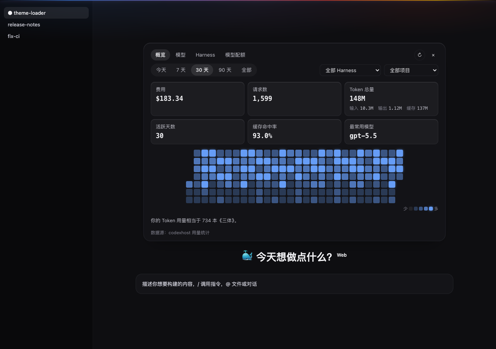

# Prism Facets · 棱镜切面

> Obsidian Prism（黑曜棱镜）配色系统的**非官方** codexhost 移植版。为 **Codex Desktop** 与 **CH Web** 提供四套光学配色、强调色、圆角、代码字体与环境棱光。
>
> Unofficial codexhost port of the [Obsidian Prism](https://github.com/RMvdesi/obsidian-prism) colour system by RMvdesi. Not affiliated with or endorsed by the original author.



| 能力 | 入口 | 说明 |
| --- | --- | --- |
| 独立页面 | `page/index.mjs` | 带实时预览的设置页（中 / 英 / 日） |
| 挂件 | `widget/index.mjs` | 主窗口可拖动的水晶速切按钮 |
| Desktop 注入 | `desktop/index.js` + `desktop/style.css` | 覆盖 Codex Desktop 的 `--app-color-*` / `--color-*` 变量 |
| Web 注入 | `web/index.mjs` + `web/style.css` | 覆盖 CH Web 的 `--dsw-*` 变量 |
| 后端 | `backend/index.mjs` | 只读扫描 Codex 会话日志，生成使用统计 |

## 功能

- **四套配色**：深色「深空黑曜」`obsidian`、「暖炭玄岩」`warm`；浅色「白昼冷晶」`crystal`、「暖白画册」`alabaster`。可跟随宿主深浅色，也可「始终深色 / 始终浅色」。
- **强调色**：跟随配色 / 钴蓝 / 鸢尾紫 / 琥珀金 / 纯银钛。
- **形状与字体**：锐利 / 宿主默认 / 柔和圆角；JetBrains Mono、Cascadia Code、SF Mono 与连字开关。
- **环境棱光**：窗口顶部 1px 光谱细线 + 淡光晕（关闭 / 低 / 中 / 高），纯静态、不拦截点击；场景预设「完整光效 / 专注编码 / 静默省电」。
- **毛玻璃菜单**：菜单与浮层背景模糊。
- **使用统计**（CH Web 新会话页的问候语上方、设置页「使用统计」标签、挂件面板右上角 ▥）：
  - 数据直接来自 **codexhost 自带的用量统计**（`codexhost/usage/statistics/get`，与「设置 → 用量统计」同一份数据，覆盖全部 Harness 并含费用）；
  - 概览：费用、请求数、Token 总量（输入 / 输出 / 缓存）、活跃天数、缓存命中率、最常用模型、最近 26 周热力图、「相当于 N 本《三体》」（共 8 本书，点击切换）；
  - 模型 / Harness：各自的 Token、占比、请求数、命中率与费用；模型配额：codexhost 托管的 Codex 账号的 5 小时 / 7 天窗口；
  - 可按 Harness、项目与「今天 / 7 天 / 30 天 / 90 天 / 全部」筛选；新会话页的面板可点 × 隐藏，或在设置中开关（`homeStats`）。
- Desktop 与 Web 通过共享 Host 同步同一份设置。

### 统计数据从哪里来

- **CH Web**：前端通过 CH Web 已登录的同源网关 `POST <base>/api/ch/v1/rpc` 调用 `codexhost/usage/statistics/get`、`codexhost/account/list`、`codexhost/account/usage/inspect`。结果在页面内缓存 15–60 秒。
- **Codex Desktop**：插件页面无法访问 Host RPC，因此改由插件后端以**只读**方式流式扫描 `~/.codex/sessions` 与 `archived_sessions`（含 `.zst`），摘要缓存在插件数据目录 `usage-cache.json`，界面会注明「数据源：Codex 日志（Desktop 回退）」。数据不会离开本机。若 Codex 数据目录不是 `~/.codex`，在插件设置「Codex 数据目录」中填写；读取 `.zst` 需要 Node.js 22.15 以上。

### 新会话页面板的实现

`web/index.mjs` 在 CH Web 新会话页找到问候语所在的 hero（CSS Modules 类名带哈希，按 `[class*="_fishHitbox"]` → `_headline` → 父元素 `_stack` 定位），用 `api.dom.mount(stack, "prepend")` 插入一个 Shadow DOM 容器；页面重新渲染时自动重新挂载，停用插件时完全移除。若 CH Web 将来改动 hero 结构，面板只会不显示，不会影响页面。

## 安装

1. 下载 `prism-facets-<版本>.zip`（或运行 `node tools/pack.mjs` 自己打包，输出在 `dist/`）。
2. 导入并启用：
   - **Codex Desktop**：打开「设置 → 插件」→ 导入 `.zip` → 启用「棱镜切面 · 光学主题」。
   - **CH Web**：左侧一级导航「插件」→ 插件中心 → 导入 `.zip` → 启用。
3. 打开设置页：
   - Desktop：「设置」左侧「插件页面」分组 →「棱镜切面」，或插件卡片上的「打开页面」。
   - Web：在「插件」工作区**顶部的切页栏**中点击「棱镜切面」。
4. 也可以在「插件详情」弹窗中直接修改设置（由 `settingsSchema` 自动生成）。

> **注意：外观主题槽位冲突**
> 本插件声明了 `appearance.theme` 槽位。如果已经启用了其他主题插件（例如 *GitHub Primer Themes*），Desktop 端会按启用顺序只让先启用的主题生效，本插件的 Desktop 注入会显示为「冲突」。请先停用其他主题插件，再启用本插件。

## 开发

```bash
node tools/build-css.mjs     # 由 shared/palettes.mjs 生成 desktop/style.css 与 web/style.css
node tools/pack.mjs          # 生成 CSS、检查体积限制并打包 dist/prism-facets-<版本>.zip
node tools/dev/serve.mjs     # 静态文件 + 真实后端桥接（可选 CH_WEB_URL/CH_WEB_TOKEN 转发到运行中的 CH Web），然后打开：
# http://127.0.0.1:8765/tools/dev/harness.html?view=home&scheme=dark&locale=zh-CN
# http://127.0.0.1:8765/tools/dev/harness.html?view=page&scheme=dark&locale=zh-CN
# http://127.0.0.1:8765/tools/dev/harness.html?view=widget&scheme=light&locale=en
```

- 所有颜色只维护在 `shared/palettes.mjs` 一处；两端 CSS 由 `tools/build-css.mjs` 生成，**不要手改** `desktop/style.css` 与 `web/style.css`。
- `desktop/index.js` 是经典脚本，不能 `import`，其中的标记逻辑需与 `markersFor()` 保持一致。
- `api.storage.set()` 会**整体替换**设置，且拒绝未在 `settingsSchema` 中声明的键；新增设置时请同时修改 `manifest.json` 与 `DEFAULTS`。

## 发布到 GitHub 与投稿市场

本仓库按 [codexhost 扩展市场](https://github.com/BytePioneer-AI/codexhost-extensions-registry) 的要求发布：

1. 递增 `manifest.json` 的 `version`，更新 `CHANGELOG.md`，提交并推送到 `main`。
2. 推送同名标签触发 Release：

   ```bash
   git tag v1.2.3 && git push origin v1.2.3
   ```

   `.github/workflows/release.yml` 会用 `tools/pack.mjs` 打包，并创建**公开正式 Release**，上传**唯一 1 个** `.zip` 资产，以及与 ZIP 内字节一致、以文件名命名的 `icon.png` 与各张截图（市场校验器会逐字节核对）。标签必须与 `manifest.json` 的 `version` 一致。
3. 首次上架：打开市场的 [提交扩展 Issue 表单](https://github.com/BytePioneer-AI/codexhost-extensions-registry/issues/new?template=submit-extension.yml)，只填写仓库主页 `https://github.com/SgAlice/codexhost-prism-facets`。机器人会读取最新 Release 的 ZIP 并做契约校验与静态扫描（拦截 `eval(`、`new Function`、`child_process`），通过后生成 `sources/prism-facets.json` 的 PR，由维护者审核合并。
4. 上架后，之后的版本只需重复 1–2，市场每 30 分钟自动同步；不会在用户设备上自动安装或启用。

也可以不经市场，直接把 Release 中的 `.zip` 或仓库链接分享给他人，在「插件」中心导入。

## 许可与致谢

- 本项目以 **GPL-3.0-only** 授权（见 `LICENSE`），因为它基于 GPL-3.0 的 Obsidian Prism 修改而来。
- 配色数值与设计来源：[Obsidian Prism](https://github.com/RMvdesi/obsidian-prism) © 2026 **RMvdesi**。按原项目 `NOTICE` 第 7 条要求，保留了原 `NOTICE`、`THIRD_PARTY_NOTICES.md`，并在设置页「关于」中显示署名；修改说明见 `NOTICE` 顶部。
- 本移植**不是**官方版本，不得用于暗示原作者的认可。
